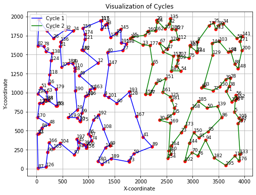
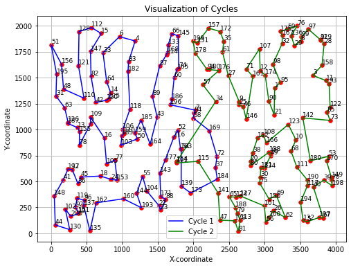

## Sprawozdanie z laboratorium nr 7
# Inteligentne Metody Optymalizacji

Autorzy: Jakub Gołąb, Mariusz Hybiak

Zadanie 7. Własna metoda

### Wprowadzenie

Celem zadania była próba poprawienia wcześniej zaimplementowanych algorytmów poprzez zastosowanie nowej metody.

- Dla każdej instancji problemu zostały przeprowadzone testy dla 100 uruchomień algorytmu.

- Do czasu działania nie jest wliczany czas generacji rozwiązań startowych, ponieważ jest on jednorazowy - rozwiązania startowe można wygenerować raz i używać wielokrotnie.

- Zadany czas działania algorytmu to 25 sekund. 

- Czas generowania 1000 par cykli w języku Python to 30 minut.

### Słowny opis metody

Jest to autorska metoda zainspirowana poprzednimi laboratoriami. Rozwiązania startowe nie są tutaj losowe. Początkowo jest generowana populacja 1000 rozwiązań. Dla każdej pary z nich sprawdzane są wspólne krawędzie. Następnie te wspólne krawędzie są zliczane i sortowane. 5% najczęściej występujących krawędzi służy do budowy rozwiązań startowych. Dalej rozwiązania te są rozbudowane poprzez dodawanie wierzchołków metodą greedy. Na tak powstałych pełnych cyklach uruchamiany jest algorytm ILS2 o zmiennym rozmiarze perturbacji. Jeśli perturbacja nie poprawia wyniku, to jest ona zwiększana. Jeśli w ciągu 10 iteracji nie udało się poprawić wyniku, to algorytm uruchamia lokalne przeszukiwanie. Ma to na celu optymalizację czasową działania algorytmu.

### Pseudokod

```pseudocode
# wygeneruj 1000 rozwiązań startowych metodą LS greedy lub wczytaj je z pliku

cycles_set = []

if cycles_file not exists
    for i in range(1000)
        cycles = gen_random_cycles()
        cycles = local_search_greedy(cycles)
        cycles_set.append(cycles)

# oblicz wspólne krawędzie dla każdej pary rozwiązań

for i in range(len(cycles_set))
    for j in range(i+1, len(cycles_set))
        common_edges = common_edges(cycles_set[i], cycles_set[j])
        common_edges_set.append(common_edges)

# zliczaj wspólne krawędzie

c = dict()
for edge in common_edges_set
    if edge not in c
        c[edge] = 1
    else
        c[edge] += 1

# wybierz 5% najczęściej występujących krawędzi

sorted_c = sort(c, by=len)
top_5 = sorted_c[:len(sorted_c) * 0.05]
sorted_c = sort(top_5, by=first_vertex_x)

# utwórz początek cyklu pierwszego z połowy krawędzi
# utwórz początek cyklu drugiego z drugiej połowy krawędzi

cycle1 = []
cycle2 = []

N = len(sorted_c)
for i in range(len(sorted_c))
    if i < N/2
        if vertex not in cycle1
          cycle1.append(sorted_c[i].first_vertex)
          cycle1.append(sorted_c[i].second_vertex)
    else
        if vertex not in cycle2
          cycle2.append(sorted_c[i].first_vertex)
          cycle2.append(sorted_c[i].second_vertex)

# dodaj wierzchołki metodą greedy uzupełniając cykl pierwszy
# dodaj wierzchołki metodą greedy uzupełniając cykl drugi

free_vertices = nodes - set(cycle1 + cycle2)

beginning_cycle1 = greedy(cycle1, free_vertices)
beginning_cycle2 = greedy(cycle2, free_vertices)

best_len = calc_len(beginning_cycle1) + calc_len(beginning_cycle2)

# dopóki nie minie zadany czas

cycle1 = beginning_cycle1
cycle2 = beginning_cycle2
size = 0.1

while elapsed_time < 25 s

    # zrób perturbację i odbuduj cykl metodą greedy
    c1, c2 = serve_perturbation(cycle1, cycle2, size)

    # jeśli perturbacja nie poprawia wyniku
    len_after = calc_len(c1) + calc_len(c2)
    if len_after < best_len
        best_len = len_after
        cycle1 = c1
        cycle2 = c2
    else:
        # zwiększ perturbację o 0.05
        size += 0.05
        no_improvement += 1

    # jeśli w ciągu 10 iteracji nie udało się poprawić wyniku
    if no_improvement >= 10
        # uruchom lokalne przeszukiwanie steepest
        cycle1, cycle2 = local_search_steepest(cycle1, cycle2)
        no_improvement = 0
        size -= 0.05
        if size < 0.1
            size = 0.1

    return cycle1, cycle2
```

### Wyniki

<div>
<style scoped>
    .dataframe tbody tr th:only-of-type {
        vertical-align: middle;
    }

    .dataframe tbody tr th {
        vertical-align: top;
    }

    .dataframe thead th {
        text-align: right;
    }
</style>
<table border="1" class="dataframe">
  <thead>
    <tr style="text-align: right;">
      <th>instance</th>
      <th>min time (s)</th>
      <th>mean time (s)</th>
      <th>max time (s)</th>
      <th>min length</th>
      <th>mean length</th>
      <th>max length</th>
    </tr>
  </thead>
  <tbody>
    <tr>
      <td>kroA200.tsp</td>
      <td>25.000386</td>
      <td>25.040874</td>
      <td>26.042522</td>
      <td>31262.513284</td>
      <td>31980.859761</td>
      <td>33214.320204</td>
    </tr>
        <tr>
      <td>kroB200.tsp</td>
      <td>25.0</td>
      <td>25.23375</td>
      <td>27.042993</td>
      <td>32617.154133</td>
      <td>33291.298487</td>
      <td>33402.594883</td>
    </tr>
  </tbody>
</table>
</div>


### Najlepsze cykle z metody

| kroA200 | kroB200 |
|-----------|------|
|  |  |

## Wyniki dla poprzednich metod uruchamianych na tym samym sprzęcie

|   | Instance         | Method   | min time (s) | mean time (s)| max time (s)| min length | mean length | max length |
|---|------------------|--------  |----------|-----------|----------|------------|-------------|------------|
| 0 | kroA200.tsp      | HAE      | 198.93   | 200.62    | 203.29   | 33100.94   | 36204.22    | 36990.61   |
| 1 | kroA200.tsp      | HAE+local| 265.75   | 271.73    | 277.93   | 32931.29   | 34792.19    | 36657.45   |
| 2 | kroB200.tsp      | HAE      | 197.15   | 200.63    | 205.55   | 33980.91   | 36443.62    | 37876.89   |
| 3 | kroB200.tsp      | HAE_local| 266.46   | 271.32    | 278.92   | 32808.76   | 34952.39    | 36814.39   |
| 4 | kroA200.tsp      | ILS1     | 398.44   | 401.82    | 407.15   | 35132.24   | 36467.78    | 37713.01   |
| 5 | kroA200.tsp      | ILS2     | 390.63   | 393.86    | 398.99   | 34584.21   | 36029.48    | 39188.51   |
| 6 | kroA200.tsp      | ILS2a    | 401.24   | 401.78    | 402.43   | 31287.75   | 32032.85    | 33039.64   |
| 7 | kroA200.tsp      | MSLS     | 390.59   | 393.84    | 398.97   | 35405.03   | 36231.84    | 36537.74   |
| 8 | kroB200.tsp      | ILS1     | 396.21   | 421.96    | 477.02   | 35305.11   | 36128.04    | 36766.28   |
| 9 | kroB200.tsp      | ILS2     | 388.65   | 413.78    | 467.55   | 33276.89   | 36248.18    | 39280.13   |
| 10| kroB200.tsp      | ILS2a    | 401.12   | 401.61    | 402.01   | 32143.93   | 32824.24    | 34079.99   |
| 11| kroB200.tsp      | MSLS     | 388.61   | 413.75    | 467.53   | 34859.24   | 36378.27    | 37180.01   |
| 12| kroA200.tsp	     | Greedy    |0.3899    | 0.4026    | 0.416    | 35901.48   | 38420.26    | 39846.51   |
| 13|	kroB200.tsp	     | Greedy   |0.3890	   | 0.3955    | 0.401	  | 34833.70   | 38568.98	   | 41607.48   |


## Wnioski

* Metoda wymaga dużo czasu na generację rozwiązań startowych, ale jest to jednorazowe. Opierając się na tych danych można wielokrotnie uruchamiać algorytm w poszukiwaniu optymalnego rozwiązania.

* Można znacząco skrócić czas generowania rozwiązań startowych poprzez zrównoleglenie obliczeń. Z pewnością generowanie ich w jezyku C++ z wykorzystaniem wielowątkowości (np. OpenMP) lub innym języku szybszym niż Python pozwoliłoby na znaczne skrócenie czasu.

* W niższym czasie udało się uzyskać wyniki porównywalne, a nawet lepsze (zwłaszcza dla instancji A), w porównaniu z innymi algorytmami.
Algorytm radzi sobie lepiej niż MSLS i podobnie do ILS2a przy ustalonym krótszym czasie działania.

* Algorytm zdaje się być stabilny w obrębie różnych instancji problemu.

* Możnaby spróbować zoptymalizować algorytm zmniejszając dopuszczalny czas działania lub dostosowując inne parametry.

### Kod programu

Kod programu znajduje się pod [tym linkiem](https://github.com/majsterkovic/imo/blob/main/lab7/).